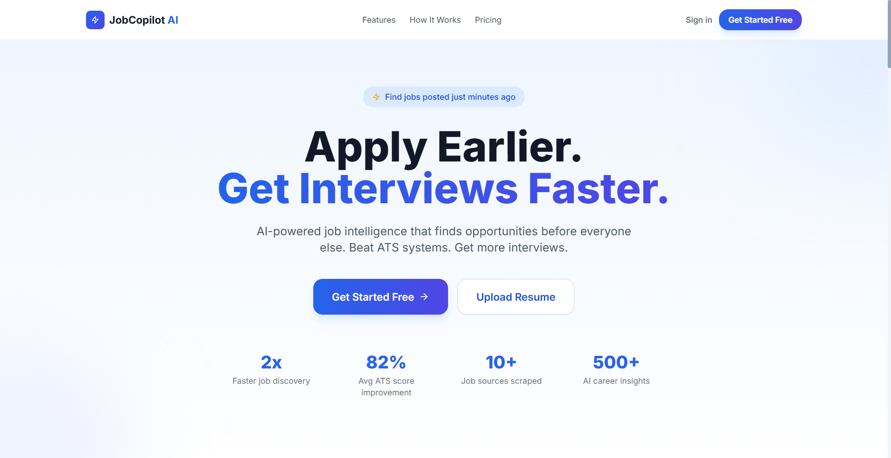
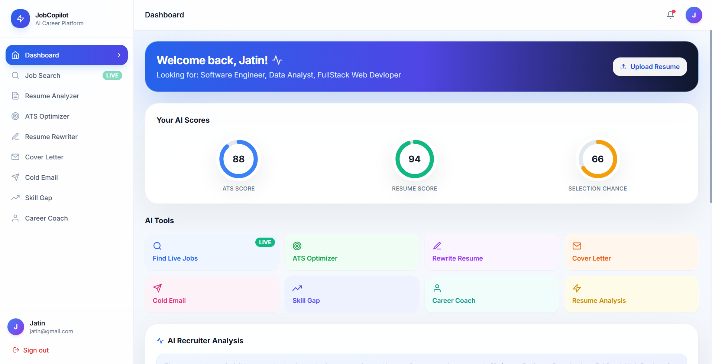
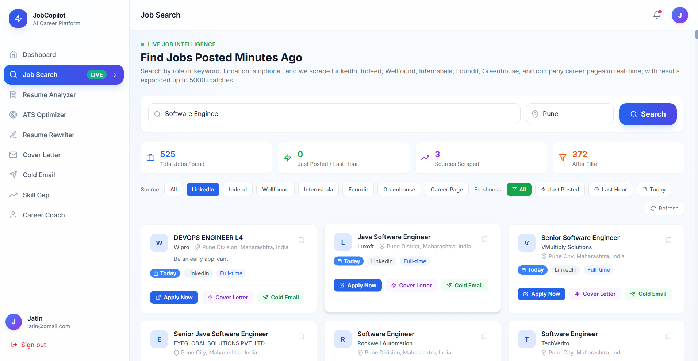
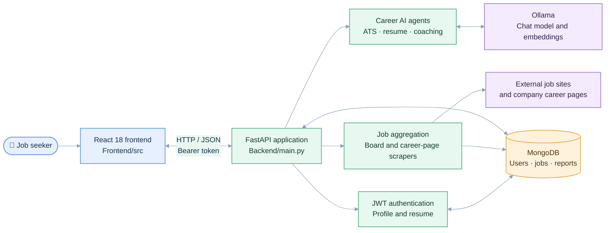

<div align="center">

# JobCopilot AI

### Your AI workspace for finding jobs and preparing stronger applications.

A full-stack job search and career toolkit with live listing aggregation, resume analysis, ATS assistance, and AI-generated career materials.


</div>

---

## ✨ Overview

JobCopilot AI brings job discovery and application preparation into one self-hosted web application. The React frontend communicates with a FastAPI backend, which stores user and job data in MongoDB and can call local Ollama models for AI workflows.

> **Local first:** AI requests run through the Ollama service you configure. Job listings are gathered from external sites and may change or be unavailable as sites update their pages or access rules.

### What you can do

| Area | Capabilities |
| --- | --- |
| **Job discovery** | Search and aggregate listings from LinkedIn, Indeed, Wellfound, Internshala, Foundit, Greenhouse boards, and selected company career pages. Filter by search terms and location; save jobs for later. |
| **Resume workspace** | Upload PDF, DOCX, or text resumes; review resume content; rewrite bullets; generate LinkedIn profile text. |
| **Application tools** | Analyze and optimize ATS fit, create tailored cover letters, and draft recruiter outreach emails. |
| **Career planning** | Explore skill gaps, learning plans, interview preparation, and career roadmaps. |
| **Personalization** | Use profile details and uploaded resume content across authenticated workflows. |

AI outputs are suggestions. Review them for accuracy and tailor them to your experience before sending an application.

## 🖼️ Screenshots

### Landing page



### Dashboard



### Job search



## 🏗️ System architecture

The diagram uses a light palette and shows the main request and data paths.



## ⚡ Start the frontend quickly

If dependencies are already installed, skip straight to `npm start`. For a clean install, use `npm ci`; it installs from the committed lockfile and avoids resolving a fresh dependency tree.

```bash
cd Frontend
npm ci       # first setup, or after package-lock.json changes
npm start    # start the React development server
```

The frontend opens at **http://localhost:3000**. Keep the backend running at **http://localhost:8000** for API-backed features. The first install and first React compilation can take longer; subsequent starts reuse the installed dependencies and build cache.

## 🚀 Run the full application locally

### Prerequisites

- Python 3.11 or later
- Node.js 20 or later with npm
- MongoDB locally or a MongoDB Atlas URI
- Ollama for AI workflows

Job scraping can run without Ollama. AI workflows need a reachable Ollama service and the configured chat model. Semantic resume-to-job matching can use `nomic-embed-text`; matching code also includes a keyword-based fallback.

### 1. Start MongoDB

Start your local MongoDB service, or create an Atlas database. The default URI is `mongodb://localhost:27017`.

### 2. Start Ollama (AI features)

Install Ollama from [ollama.com](https://ollama.com), then in a terminal run:

```bash
ollama pull qwen3:14b
ollama pull nomic-embed-text
ollama serve
```

The embedding model is optional. Change `AI_MODEL` or `EMBED_MODEL` in the backend environment to use other Ollama models.

### 3. Install and run the backend

From the repository root:

```powershell
cd Backend
python -m venv .venv
.venv\Scripts\Activate.ps1
python -m pip install -r requirements.txt
Copy-Item .env.example .env
python main.py
```

On macOS or Linux, activate the environment with `source .venv/bin/activate` and copy the environment file with `cp .env.example .env`.

Edit `Backend/.env` before sharing or deploying the service. Set a private `SECRET_KEY`, and set `MONGO_URI` if your database is not local. The API is at **http://localhost:8000**. Interactive API docs are at **http://localhost:8000/docs**.

### 4. Install and run the frontend

Open a second terminal from the repository root:

```bash
cd Frontend
npm ci
npm start
```

To use a different API origin, add `Frontend/.env`:

```env
REACT_APP_API_URL=http://localhost:8000
```

The frontend defaults to that URL. Its development server proxies API requests to port 8000 as configured in `Frontend/package.json`.

## 🐳 Docker Compose

The Compose file starts MongoDB, backend, and frontend:

```bash
docker compose up --build
```

| Service | Local address | Notes |
| --- | --- | --- |
| Frontend | http://localhost:3000 | React development server |
| Backend | http://localhost:8000 | FastAPI; docs at `/docs` |
| MongoDB | `localhost:27017` | Data stored in the `mongodb_data` volume |
| Ollama | Not included | Must run on the host; Compose points to `host.docker.internal` |

On Linux, configure an Ollama host address in `docker-compose.yml` if `host.docker.internal` is unavailable in your Docker environment. The Compose file contains a development secret. Replace it with a strong private value before use outside a private local environment, and do not expose database or API ports publicly without appropriate access controls.

## ⚙️ Configuration

Backend configuration is read from environment variables. `Backend/.env.example` contains the basic local settings.

| Variable | Default | Description |
| --- | --- | --- |
| `MONGO_URI` | `mongodb://localhost:27017` | MongoDB connection URI |
| `DB_NAME` | `jobcopilot` | Database name |
| `SECRET_KEY` | Development fallback in code | JWT signing secret; set a unique private value |
| `OLLAMA_BASE` | `http://localhost:11434` | Ollama API base URL |
| `AI_MODEL` | `qwen3:14b` | Chat model for AI agents |
| `AI_TIMEOUT_SECONDS` | `180` | AI request timeout in seconds |
| `EMBED_MODEL` | `nomic-embed-text` | Embedding model for semantic matching |
| `GREENHOUSE_BOARDS` | Empty | Optional comma-separated Greenhouse board identifiers |
| `REACT_APP_API_URL` | `http://localhost:8000` | Frontend API base URL |

Keep `.env` files and production secrets private. The default JWT key is for development only.

## 🛠️ Development

- Frontend production build: run `npm run build` inside `Frontend`.
- Backend dependencies: install `Backend/requirements.txt` in a Python virtual environment.
- Backend smoke tests: from `Backend`, install pytest and run `pytest tests/ -v`.
- Start the API from inside `Backend` so the local module imports resolve correctly.

Scraper behavior depends on external websites and can change when their markup, access, or policies change. Follow the terms and applicable rules for each source. AI-generated analyses are not guarantees of ATS results, interview selection, salary, or hiring outcomes.

## 📄 License

Released under the [MIT License](LICENSE). Copyright © 2026 Jatin Shewale.

